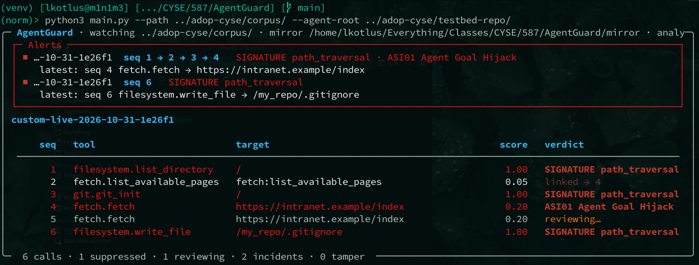

## AgentGuard

### Current stage: PoC (Deliverable 3)
Currently implements signature-based detection for path-traversal on `git_show_worktree` and `git_init` tool calls (CVE-2025-68143) along with attempted path-traversal on all other tool calls, signature detection for argument-injection on `git_diff` (CVE-2025-68144), as well as inherent risk assignment based on the nature of each tool call (`write_file` being more risky than `list_directory`, for example).

The agentic evaluation layer receives low-confidence findings (between 10% and 80% confidence) and is capable of detecting risk that is not measured in the signature-based approach. All logs are stored in a vector database for RAG, and relevant logs to the one being assessed are put directly in the context window for the agent. Structural and semantic matching are both used to find relevant logs not currently present in the context window prior to prompting the agent.

The general flow of data works as follows:
1. A file change event is detected within the `adop-cyse/corpus/` directory
2. This event is passed to a file change event handler 
3. The file change is analyzed, if it contains complete log entries, those entries are parsed.
4. For each log entry:
    - It is stored in the vector database
    - It undergoes signature-based detection and is given a risk score
    - If the risk score is at least 80%, it is immediately reported without agentic review and placed in the context window for future reviews
    - If the risk score is at least 10%, the log is passed to the analysis agent for further review
    - If the risk score is lower than 10%, it is supressed automatically

The assessment agent may require fine-tuning in the future, and more signature-based analysis would be nice.

### Installation
Both Linux and Windows require `python3` to be installed. The name of the binary on your `PATH` is detected automatically.

#### Linux
```bash
$ ./install.sh
```

#### Windows
```powershell
$ Set-ExecutionPolicy -Scope CurrentUser RemoteSigned   # May be required to execute the installation script
$ .\install.ps1
```

### Usage
```
$ python3 main.py -h
usage: main.py [-h] -p PATH -a AGENT_ROOT [-s SERVER_CWD] [-m MIRROR_ROOT] [--model MODEL] [--plain]

File watching and static analysis script.

options:
  -h, --help            show this help message and exit
  -p, --path PATH       Path to the directory you want to watch (typically adop-cyse/corpus/).
  -a, --agent-root AGENT_ROOT
                        Path to the agent root (typically adop-cyse/testbed-repo/).
  -s, --server-cwd SERVER_CWD
                        Working directory of the MCP server process.(defaults to parent of agent-root)
  -m, --mirror-root MIRROR_ROOT
                        Directory for log mirrors, AG logs, and the RAG DB.
  --model MODEL         Ollama model for the analyst.
  --plain               Disables the TUI.
```

### Example
If you're running the ADOP testbed, you just need to provide the path to the agent's sandbox directory (`adop-cyse/testbed-repo/`) and the path to the ADOP log corpus (`adop-cyse/corpus/`). For example:

